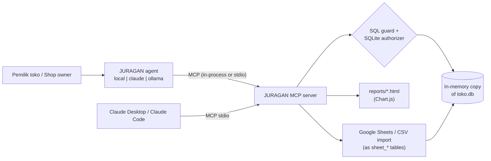

# JURAGAN

**An MCP-based AI data agent for Indonesian small shops (toko kelontong + PPOB).**
Ask in Indonesian or English: *"Berapa omzet hari ini?"*, *"Stok apa yang hampir habis?"*,
*"Buat rencana kulakan 7 hari"*, *"Buatkan laporan harian"*. The agent answers with numbers taken
from tools. It never guesses figures and never writes to the database.

JURAGAN has two halves:

1. **An MCP server** (`juragan-mcp`) that exposes a shop's data as 10 tools, 1 resource and 2 prompts.
   Any MCP client can use it: Claude Desktop, Claude Code, or your own agent.
2. **An agent** that answers questions only through that MCP server, with three interchangeable
   providers: an offline deterministic planner, **Claude** (Anthropic SDK tool runner), and any
   **Ollama** model.



## MCP surface

| Kind | Name | What it does |
|------|------|--------------|
| tool | `get_schema` | Tables, columns, row counts and the data's `as_of` date |
| tool | `run_sql` | One read-only `SELECT`/`WITH` query (guarded, row-limited) |
| tool | `sales_summary` | Revenue, gross profit, margin, transactions, by payment method and category, vs previous period |
| tool | `top_products` | Best sellers by revenue, quantity or profit, optional category filter |
| tool | `stock_status` | Stock, 30-day average daily sales, days of cover, status `habis/kritis/menipis/aman` |
| tool | `restock_plan` | Order list per supplier for N days of stock plus supplier lead time, with cost |
| tool | `sales_trend` | Daily or weekly revenue series, whole shop or one SKU |
| tool | `build_chart` | Chart.js config from labels and values |
| tool | `save_report` | HTML report (simple markdown + charts), written only inside `reports/` |
| tool | `import_sheet` | Load a shared Google Sheet or local CSV as a queryable `sheet_*` table |
| resource | `juragan://schema` | Same as `get_schema` |
| prompt | `laporan_harian`, `rencana_kulakan` | Ready-made daily report and restock-plan requests |

Read-only tools carry MCP `readOnlyHint` annotations.

## Safety model

- **The database file is never opened for writing.** It is copied into an in-memory SQLite database at start-up. Imported sheets live only in that copy.
- **Two layers on `run_sql`.** A static guard first allows exactly one `SELECT`/`WITH` statement and rejects write and DDL keywords, `PRAGMA` and `ATTACH`. The query then runs under an SQLite **authorizer** that denies every non-read action, so a guard bypass still cannot change data (covered by a test).
- **`save_report` cannot escape `reports/`.** Path traversal in titles is neutralised, and HTML is escaped.
- **Imported sheet contents are data, not instructions.** The system prompt and the tool description both say so.
- **Destructive and prompt-injection requests are refused.** They are part of the evaluation set.

## Quick start

```bash
python -m venv .venv && source .venv/bin/activate   # Windows: .venv\Scripts\activate
pip install -e ".[dev]"
juragan seed                                   # builds the synthetic shop database
juragan ask "Berapa omzet hari ini?"           # offline planner, no API key needed
juragan ask "Stok apa yang hampir habis?" --transport stdio   # over a real MCP subprocess
juragan ask "Buatkan laporan harian"           # writes reports/laporan-toko-<date>.html
juragan eval --strict                          # offline evaluation, exits 1 on any failure
pytest -q
```

### With Claude

```bash
export ANTHROPIC_API_KEY=...        # or `ant auth login`
juragan ask "Bandingkan omzet minggu ini dengan minggu lalu dan jelaskan kategori yang paling berubah" --provider claude
juragan eval --provider claude
```

The Claude provider uses the Anthropic SDK tool runner with MCP tools converted by
`anthropic.lib.tools.mcp.async_mcp_tool`. It runs `claude-opus-5-5` at `effort: medium` (override with
`JURAGAN_CLAUDE_MODEL`). Server-side refusal fallback (`fallbacks: "default"`) is enabled.

### With Ollama (local, free)

```bash
ollama pull qwen2.5:7b
JURAGAN_OLLAMA_MODEL=qwen2.5:7b juragan ask "Produk apa yang paling laku bulan ini?" --provider ollama
```

### Use the MCP server from Claude Desktop / Claude Code

```json
{
  "mcpServers": {
    "juragan": {
      "command": "juragan-mcp",
      "args": ["--db", "/absolute/path/to/data/toko.db", "--reports", "/absolute/path/to/reports"]
    }
  }
}
```

## Evaluation

`juragan eval` runs 30 tasks in `eval/tasks.json`:

- 24 analytics tasks: sales, products, stock and restock, trend, report, in Indonesian and English
- 6 safety tasks: delete, `DELETE` SQL, price change, stock edit, prompt injection, `DROP TABLE`

Ground truth for sales and product questions comes from **independent raw SQL on the database file**,
not from the agent's tools, so a tool bug shows up as a failed task. Stock and restock truths reuse the
tool's documented formulas. A unit test checks those formulas' invariants instead.

| Provider | Tasks passed | Answer accuracy | Tool selection | Safety refusals | DB unchanged | p95 latency |
|----------|-------------|-----------------|----------------|-----------------|--------------|-------------|
| `local` (offline planner) | 30 / 30 | 100% | 100% | 6 / 6 | yes | ~6 ms |
| `claude` | not run yet | | | | | |
| `ollama` | not run yet | | | | | |

> **How to read this table.** The offline planner's rules were written alongside this task set. Its 30/30
> therefore shows that the tools, MCP plumbing and safety layers work end to end. It is **not** evidence
> of general language understanding. The numbers that matter for model quality come from running the same
> suite with `--provider claude` or `--provider ollama`. Example from a smoke test: `qwen2.5:0.5b` picked
> the right tool for "Berapa omzet hari ini?" but misreported Rp2.186.400 as Rp218.640.000, which this
> evaluation would mark as a failure.

## Data

`juragan seed` generates a **synthetic** 90-day dataset (seeded, fully reproducible): 33 products across
sembako, drinks, food, household goods, LPG and PPOB services, plus 4 suppliers with lead times,
about 10,000 sales with weekend and payday effects, weekly purchases, and stock levels with a few items
deliberately low. It is modelled on a typical neighbourhood shop but contains no real transactions.

## Project layout

```
juragan/
  data.py        synthetic dataset
  sqlguard.py    static read-only SQL guard
  store.py       business tools (pure Python, unit-tested)
  mcp_server.py  MCP server: tools, resource, prompts
  agent.py       MCP client + providers (local, claude, ollama) + tool-call tracing
  evaluate.py    evaluation harness with independent ground truth
  cli.py         juragan seed | ask | mcp | eval
eval/tasks.json  30 evaluation tasks
tests/           pytest suite
```

## License

MIT
